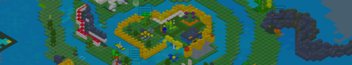

# Nimiq Space

<p align="center">
  
</p>

**Nimiq Space** is an open multiplayer world for the [Nimiq](https://nimiq.com) community - a shared isometric map where wallet-signed players can see who is here right now, build together, and leave something that lasts.

<p align="center">
  <a href="https://nimiq.space">
    
  </a>
</p>

### Social

Chat apps scatter people into language silos. Here you occupy the same space: walk the hub and Commons, chat or whisper, portal between rooms, and show up as a living presence on the map - the quiet signal that someone else who shares Nimiq is online with you.

### Pixel

The **Pixel** room is a persistent **500×500** collaborative floor. Paint tiles that stay for the next visitor. No blocks, just color - a living mural the community keeps returning to (also available as a live `/pixels.png` snapshot).

### Play

Take it to the **Play Field**: seasonal soccer with challenges, kickoff countdowns, match pitches, and spectators in the stands. Same world, different energy - drop in, compete, watch.

### Build

Shape rooms with blocks, floors, gates, signposts, billboards, and teleporters. What you place syncs for everyone in the room. Own a space, invite friends into a private Play Space, or leave a landmark for strangers to find later.

---

### Last 30 days

_Snapshot from production analytics (UTC window ending 2026-07-31)._

| Metric | Value |
|--------|------:|
| Unique visitors | **253** |
| First-time sign-ins | **141** |
| Nimiq Pay unique | **101** (40% of visitors) |
| Other unique (non-Pay) | **152** (60% of visitors) |
| Pay first-time / returning | **75** / **26** |
| Active play (AFK-capped) | **1,120h** |
| NIM paid out | **202,630** |
| NIM to Pay cohort | **41,672** |

Top chosen countries (flag identity, not location): **TR** 11 · **CO** 10 · **AR** 8 · **IN** 7 · **DE** / **IR** / **NL** 6 each.

---

## About

<p>
  
</p>

**Builder** · [`NQ97 4M1T 4TGD VC7F LHLQ Y2DY 425N 5CVH M02Y`](https://nimiq.space)

<br clear="all" />

### Builder story

I grew up on internet forums. The ability to communicate with others around the world over a common subject has been lost. I kind of miss this.

Chat apps like Telegram and Discord miss the mark, as it feels impersonal. Non-English speaking users are confined to their own single-language-only channels, and there is rarely any cross communication between them.

Nimiq Space fits a niche where users can see each other occupying a shared (Nimiq) space, indicating to others that "I'm here right now," which is encouraging for real-life asynchronous communication. Accessibility features were implemented to allow for quick translating between languages.

Nimiq here is the common connection. Any active users silently share this connection and can quickly socialize with others. There's a long way to go, but we've only just planted the seeds :)

---

## Run locally

**Needs:** [Node.js 20–26](https://nodejs.org/) (**22 LTS recommended**) and npm. Node 26 needs `better-sqlite3` ≥12.11 (already in this repo). Avoid odd/current majors until native addons catch up if install fails.

```bash
git clone https://github.com/Harlski/nspace.git
cd nspace
npm install
cp server/.env.example server/.env
cp client/.env.example client/.env.development
```

(`npm run dev` also creates those files from the examples if they are missing.)

Local placeholders already include `DEV_AUTH_BYPASS=1` / `VITE_DEV_AUTH_BYPASS=1` and a local `JWT_SECRET` - do not use those in production.

```bash
npm run dev
```

Open [http://localhost:5173](http://localhost:5173) → **Dev login**. Client **5173**, server **3001**.

Wallet sign-in: turn bypass off and use **Connect wallet** via [Nimiq Hub](https://hub.nimiq.com).

**QR Pay login on LAN:** leave `PUBLIC_BASE_URL` unset so the server embeds your LAN IP + Vite port in the QR, or set e.g. `PUBLIC_BASE_URL=http://192.168.1.10:5173` in `server/.env`. Phone and desktop must reach that origin (Vite already listens on the LAN). Open desktop on that same Network URL (not only localhost) if the QR points at the LAN host.

### Troubleshooting

| Symptom | Check |
|---------|--------|
| Server exits on start | `server/.env` exists with `JWT_SECRET` |
| No Dev login button | `DEV_AUTH_BYPASS=1` + `VITE_DEV_AUTH_BYPASS=1`; restart `npm run dev` |
| Page loads, no connect | Server listening on **3001**; ports free |
| Phone / LAN / QR | Vite **Network** URL; firewall **5173** + **3001**; `PUBLIC_BASE_URL` matches a host the phone can open |

Full setup, controls, Docker: **[docs/getting-started.md](docs/getting-started.md)**.

---

## Repo map

| Path | Role |
|------|------|
| `client/` | Vite · TypeScript · Three.js |
| `server/` | Express · WebSocket · room authority |
| `docs/` | Architecture, deploy, process |

Start at **[docs/README.md](docs/README.md)**. Contributing: **[docs/CONTRIBUTING.md](docs/CONTRIBUTING.md)** · agent map: **[AGENTS.md](AGENTS.md)**.

## License

Nimiq Space is available under the [MIT License](LICENSE).
